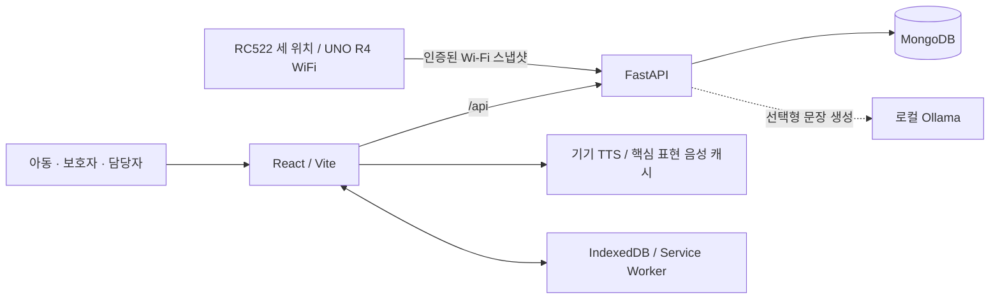

# PESC MATE

> 익숙한 그림 한 장이 나의 말이 되도록, 개인 맞춤형 AAC 웹 애플리케이션


PESC MATE는 말로 의사를 표현하기 어려운 아동이 그림·사진·글자 카드를 선택해
자신의 뜻을 음성으로 전달하는 AAC(보완대체의사소통) 프로젝트입니다.
실물 카드북의 휴대·분류·교체 부담을 줄이고, 아동의 말하기와 보호자·담당자의 지원을 연결합니다.

카드 위치의 일관성과 사용자의 명시적 선택을 우선합니다. AI나 네트워크의 장애가 기본
말하기를 막지 않도록 대체 경로를 두고, 의사소통 기록과 학습 결과는 구분해 관리합니다.
현재 로컬 실행형 MVP를 구현했으며 실제 사용자·기기 검수와 운영 배포 승인은 별도 과제입니다.

[설치 방법](#설치-방법) · [사용 예제](#사용-예제) ·
[개발 환경 설정](#개발-환경-설정) · [업데이트 내역](#업데이트-내역) ·
[정보](#정보) · [기여 방법](#기여-방법)

## 설치 방법

### Docker로 실행

Windows는 Docker Desktop의 Linux 컨테이너 모드를 사용합니다.
macOS·Linux도 Docker와 Docker Compose v2가 필요합니다.
처음에는 이미지·의존성을 내려받을 인터넷 연결이 필요합니다.

저장소를 내려받은 후 프로젝트 루트에서 실행합니다.

```sh
git clone https://github.com/PESC-MATE/pesc-mate.git
cd pesc-mate
docker compose up --build
```

| 접속 대상 | 주소 |
|---|---|
| 웹 화면 | http://127.0.0.1:5173 |
| API 문서 | http://127.0.0.1:8000/docs |
| 준비 상태 | http://127.0.0.1:8000/api/health |

종료할 때는 다음 명령을 사용합니다. MongoDB 데이터 볼륨은 유지됩니다.

```sh
docker compose down
```

기본 구성은 시연 계정과 무인증 DB를 사용하는 **로컬 개발용**입니다. 인터넷에 공개하지 마세요.
소스 변경은 개발 서버에 자동 반영됩니다. 개별 실행·선택형 AI·태블릿 연결은
[로컬 개발 가이드](docs/development/LOCAL_DEVELOPMENT.md)를 참고하세요.

## 사용 예제

### 시연 계정

Compose 실행 시 아래 계정을 활성화하며, 기존 계정의 비밀번호는 덮어쓰지 않습니다.

| 아이디 | 비밀번호 | 역할 |
|---|---|---|
| `demo` | `demo1234` | AAC 사용자 |
| `caregiver` | `caregiver1234` | 보호자 |
| `support` | `support1234` | 담당자 |
| `admin` | `admin1234` | 공용 콘텐츠 관리 권한을 가진 담당자 |

### 주요 기능

| 기능 | 사용 방법 |
|---|---|
| 그림으로 말하기 | 카드를 탐색하고 최대 12장으로 문장을 구성해 기기 음성으로 재생합니다. 빠른 표현·긴급/복구 표현·마지막 말 재생도 제공합니다. |
| 개인 카드북 | 사진을 일괄 등록하고 이름·분류·순서를 편집합니다. 사진을 교체해도 카드 ID·문구·배치를 유지하며 핵심 카드는 잠글 수 있습니다. |
| 상황별 카드판 | 같은 아동의 집·학교·외출 등 카드판을 생성·복사하고, 아동이 미리보기를 확인한 뒤 전환합니다. 추천은 고정 배치를 바꾸지 않습니다. |
| 실물 RFID 카드판 | UNO R4 WiFi·RC522 세 위치의 현재 배열을 Wi-Fi로 받아 기존 문장에 명시적으로 적용합니다. 장치 인증·아동별 UID 매핑을 구현했으며 세 리더기 실물 검수는 남아 있습니다. |
| 학습 활동 | 단어·그림 맞추기, 소리 듣고 카드 찾기, 카드 순서로 문장 만들기를 제공합니다. 문제 수·반복·재도전을 설정하며 학습 결과는 말하기 기록과 별도로 관리합니다. 문장 연습은 예문별 2~3장을 사용합니다. |
| 보호자·담당자 지원 | 연결된 아동의 허용된 기록을 보고 지원 메모·기간별 내보내기·추천 설정을 사용합니다. |
| 오프라인·접근성 | 준비된 카드·설정 캐시와 대기 기록 동기화, 고대비·동작 줄이기·크기/글자 설정·키보드 접근을 지원합니다. |

1. `demo`로 로그인해 **그림으로 말하기**에서 카드를 선택하고 음성을 재생합니다.
2. **연습하기**에서 활동을 선택합니다. 소리 학습은 **문제 소리 듣기** 버튼으로 시작합니다.
3. 보호자 계정에서 연결된 아동의 개인 카드·핵심 잠금·상황별 카드판을 관리합니다.
4. 보호자·담당자 계정에서 의사소통/학습 기록과 허용된 지원 기능을 확인합니다.

시연에는 실제 아동의 사진·이름 대신 데모 데이터를 사용하세요.
새 DB에서는 동의·연결 상태에 따라 기록과 지원 기능이 제한됩니다.
해당 기능이 필요한 경우에만 개인정보·동의 관리에서 동의를 명시적으로 저장하고 연결·권한을 확인합니다.

개인정보·동의 관리는 **보호자 설정**에 있습니다. 동의 전에도 새 의사소통·학습 이력을
저장하지 않는 기본 말하기와 연습은 유지합니다. 로그인까지 없애는 익명 모드는 아니며,
설정 화면의 분리가 법정대리인 신원 인증을 대신하지는 않습니다.

오프라인은 사전 캐시와 기기 음성 지원이 필요하고, 소리 학습은 한국어 로컬 음성이 필요합니다.
LAN HTTP에서는 서비스 워커 기반 설치·완전 오프라인 검수를 할 수 없습니다.
실제 기기 연결 조건은 [검수 가이드](docs/validation/ACTUAL_USE_VALIDATION.md)에 있습니다.

실물 RFID 확장의 배선 제안·펌웨어·서버 실행·태그 등록 방법은
[Wi-Fi 카드판 연동 안내](docs/development/RFID_WIFI_INTEGRATION.md)를 참고하세요.
현재 배열은 화면의 적용 버튼으로 문장에 넣으며 스캔만으로 자동 발화하지 않습니다.

## 개발 환경 설정

### 기술 스택

| 영역 | 기술 |
|---|---|
| 프런트엔드 | React, Vite, JavaScript, Web Speech API |
| 백엔드 | Python 3.12, FastAPI, Uvicorn, PyMongo, Pillow |
| 데이터·오프라인 | MongoDB 8.0, IndexedDB, Service Worker |
| 선택형 AI | Ollama, 기본 설정 모델 `qwen2.5:0.5b` |
| 실행·검증 | Docker Compose, Node.js Test Runner, Vitest, Testing Library, Python unittest, Playwright |

Ollama와 모델은 별도로 설치합니다. 모델이 없거나 실패하면 규칙 기반 문장과 선택 카드
발화로 대체하며, 기기 TTS는 AI와 독립적으로 동작합니다.

### 구조와 주요 설계



- **배치 안정성**: 고정 슬롯·핵심 잠금·명시적 상황 전환으로 익숙한 카드 위치를 보호합니다.
- **데이터 일관성**: 카드판 revision·사진 버전 검사로 충돌을 감지하고, 같은 요청 UUID의 재전송은 중복 저장하지 않습니다.
- **접근 경계**: 서버에서 아동 소유자·지원 연결·기능별 권한을 검사하고 기기 캐시도 계정별로 구분합니다.
- **사진 보관**: 원본은 로컬 MongoDB에 보관하고, 화면에는 메타데이터를 제거한 WebP·썸네일을 제공합니다.
- **의미·기록 분리**: AI 출력의 선택 카드 의미를 검사하고, 학습과 의사소통 저장소·동의 편집 초안과 확정 상태를 분리합니다.

```text
frontend/       웹 화면, 기기 음성·캐시 서비스, 단위·컴포넌트·E2E 검사
backend/        API, 권한·문장·이미지·기록 서비스, 단위·통합 검사
hardware/       세 위치 RFID Wi-Fi 펌웨어, 비밀 설정 예제와 배선·검수 안내
scripts/        로컬 검증 실행기와 PowerShell·셸 진입점
deployment/     인증 MongoDB 구성
docs/           기획·개발·정책·운영·검증 문서
compose*.yaml   개발·태블릿·격리 검증 구성
```

### 테스트와 빌드

로컬 검증에는 Docker와 Node.js **22.13 이상 22.x, 24.x 또는 26 이상**이 필요합니다.
루트 패키지는 외부 의존성이 없어 별도 `npm install` 없이 실행합니다.

```sh
npm run verify           # 단위·컴포넌트 검사와 프런트엔드 빌드
npm run verify:full      # 위 범위 + 격리 MongoDB 통합 + Chromium E2E
```

프런트엔드만 호스트에서 개발하려면 별도 터미널에서 실행합니다.
백엔드·MongoDB는 먼저 준비해야 합니다.

```sh
cd frontend
npm ci
npm run dev
```

같은 `frontend` 디렉터리에서 `npm test`와 `npm run build`로 개별 검증합니다.
GitHub Actions 원격 CI 대신 로컬 실행기를 사용하며, 검증용 DB·포트는 개발 환경과 분리합니다.
결과는 Git에서 제외된 `.local-validation/`에 저장합니다.

2026-10-27 RFID Wi-Fi 연동까지 포함한 **전체 `npm run verify:full` 실행 결과**입니다.

| 검증 범위 | 결과 |
|---|---|
| 실행기·초기화 정책 | 28개 통과 |
| 프런트엔드 | Node 103개 + React 190개, 총 293개 및 빌드 통과 |
| Linux 백엔드 단위 | 395개 통과, 제외 없음 |
| 격리 MongoDB 통합 | 93개 통과, 제외 없음 |
| Chromium 전체 | 55개 통과, 합성 RFID 장치·TTS 스텁 사용 |

총 **864개 검사와 빌드·임시 환경 정리**를 통과했습니다.
이는 자동 회귀 검증이며 실제 기기 음질·AAC 사용자 과업이나 운영 배포 승인을 대신하지 않습니다.
[검증 실행 방법](docs/validation/ONE_COMMAND_VALIDATION.md)과
[최신 기능 검증 기록](docs/development/RFID_WIFI_INTEGRATION.md)을 참고하세요.

## 업데이트 내역

릴리스 버전을 새로 부여하지 않고 기능별 개발 기록과 실제 커밋 기준으로 정리했습니다.

| 날짜 | 변경 내용 | 커밋·기록 |
|---|---|---|
| 2026-10-27 | RFID 세 위치 수신·장치 인증·아동별 UID 매핑·기존 문장/TTS 적용, 실물 검수 대기 | [연동 기록](docs/development/RFID_WIFI_INTEGRATION.md) |
| 2026-10-24 | 카드 순서로 문장 만들기, 선택 재개·재도전·학습 전용 결과 | [개발 기록](docs/development/SENTENCE_ORDER_LEARNING.md) |
| 2026-10-24 | 소리 듣고 카드 찾기, 명시 재생·학습 결과 분리·오프라인 동기화 | `5ac2902` |
| 2026-10-24 | 보호자 동의 관리와 아동의 기록 없는 기본 말하기 분리 | `e85fd3e` |
| 2026-10-24 | 상황별 카드판 생성·복사·전환 | `beb3344` |
| 2026-10-23 | 핵심 카드 잠금과 위치 보호 | `712e5e6` |
| 2026-10-23 | 카드 정보·배치를 유지하는 개인 사진 교체 | `043241a` |
| 2026-10-23 | 가져온 카드 순서의 슬롯 적용 | `6c3808d` |

전체 구현 상태와 다음 과제는 [통합 TODO](docs/planning/TODO.md)에서 관리합니다.

## 정보

- 프로젝트 저장소: [PESC-MATE/pesc-mate](https://github.com/PESC-MATE/pesc-mate)
- 하드웨어 확장: [Arduino 카드판 코드·안내](hardware/README.md) — Wi-Fi 연동 구현, 실제 세 리더기 검수 대기
- 문서: [전체 목차](docs/README.md) · [API 명세](docs/development/API_SPECIFICATION.md) · [기능요구사양서](docs/planning/functional_requirements_specification.md)
- 남은 검수: 실제 AAC 사용자 과업, 태블릿 TTS·스크린리더·터치 사용성, 법정대리인 동의·이미지 권리 검토
- 운영 전환: HTTPS·운영 자격 증명·인증 DB 전환, 백업/복구 훈련과 배포 승인
- 라이선스: 현재 저장소에 `LICENSE` 파일이 없습니다. 코드·이미지의 사용 및 배포 조건은 별도 확인이 필요합니다.

의사소통 보조와 연습을 위한 소프트웨어이며 임상 효과·진단 기능·공식 PECS 인증을 주장하지 않습니다.
문장 연습은 [정해진 예문 따라 만들기](docs/development/SENTENCE_ORDER_LEARNING.md)이며,
자유 문장 채점·상황 연습 등 추가 학습 콘텐츠는 후속 확장 범위입니다.

## 기여 방법

1. 변경 목적과 영향 범위를 정리하고 별도 작업 브랜치에서 수정합니다.
2. 기능·문서의 정책과 [통합 TODO](docs/planning/TODO.md)를 함께 확인합니다.
3. 변경 범위에 맞는 검증을 실행하고, 실패·미실행 항목을 기록합니다.
4. [커밋 규칙](docs/development/COMMIT_CONVENTION.md)에 따라 작업 단위로 커밋합니다.
   제목은 `feat : 한글 설명`, `docs : 한글 설명` 형식을 사용합니다.
5. 변경 내용과 검증 결과를 포함해 Pull Request로 제안합니다.

README 구성은 [한국어 README 템플릿](https://github.com/sujinleeme/readme-template/tree/master/korean)을 참고했습니다.
