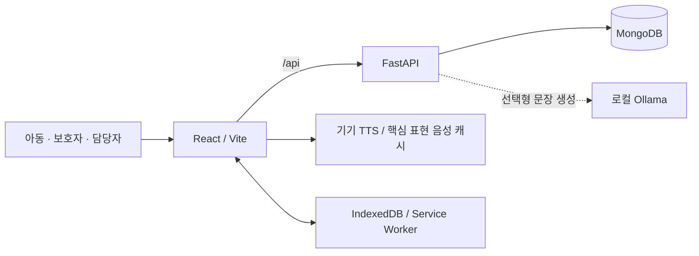

# PESC MATE


**익숙한 그림 한 장이 나의 말이 되도록.**

PESC MATE는 말로 의사를 표현하기 어려운 아동이 그림·사진·글자 카드를 골라
자신의 뜻을 음성으로 전달하는 **개인 맞춤형 AAC(보완대체의사소통) 웹 애플리케이션**입니다.
아동의 말하기, 보호자·담당자의 카드북 관리, 별도의 어휘 연습을 하나의 흐름으로 연결합니다.

[핵심 기능](#핵심-기능) · [설계와 문제 해결](#설계와-문제-해결) ·
[로컬 실행](#로컬-실행) · [검증](#검증) · [문서](docs/README.md)

> 로컬 실행형 MVP와 자동 회귀 검증을 구현한 프로젝트입니다.
> 실제 AAC 사용자·태블릿 검수와 외부 운영 배포 승인은 별도 과제로 남아 있습니다.

## 프로젝트 배경

실물 그림 카드북은 카드가 늘어날수록 휴대·분류·교체가 어려워집니다.
디지털로 옮기더라도 카드 위치가 갑자기 바뀌거나, 네트워크와 AI의 응답을 기다려야 한다면
정작 필요한 순간에 말을 전하기 어렵습니다.

이 프로젝트는 기능을 늘리는 것보다 **사용자가 익숙한 위치에서 표현을 찾고,
직접 선택한 뜻을 끝까지 전달할 수 있는 것**을 우선했습니다.

- **아동**: 그림으로 말하기, 긴급·복구 표현, 단어와 소리 연습
- **보호자**: 개인 사진 카드, 카드판·음성·학습 설정, 개인정보·동의 관리
- **담당자**: 연결된 아동의 허용된 기록 조회, 지원 메모, 카드 관리

## 핵심 기능

### 1. 그림으로 말하기

카드를 검색하거나 분류별로 탐색하고, 최대 12장을 선택해 문장을 구성합니다.
기기 음성으로 선택한 표현을 읽고 일시 정지·재개·중지하거나 마지막 말을 다시 들을 수 있습니다.
빠른 표현과 긴급·복구 표현은 문장 작성이나 학습과 별개로 사용할 수 있습니다.

선택형 로컬 LLM은 한국어 조사·어순을 보완하되 선택하지 않은 의도를 덧붙이지 않도록
출력 검사를 거칩니다. 모델이 없거나 실패해도 규칙 기반 문장과 선택 카드 발화를 유지합니다.

### 2. 나만의 카드북과 상황별 카드판

개인 사진을 한 번에 등록하고 이름·분류·순서를 확인해 카드판에 반영합니다.
사진 교체 시 카드 ID와 문구·배치를 유지하고, 핵심 카드 잠금으로 익숙한 위치를 보호합니다.
집·학교·외출 등 상황별 카드판은 같은 아동 안에서 생성·복사하며,
아동이 미리보기를 확인하고 직접 전환합니다. 추천이 고정 카드판을 자동 재배열하지 않습니다.

업로드 원본은 로컬 MongoDB에 보관하고, 화면에는 메타데이터를 제거한 WebP와 썸네일을
제공합니다. 이미지 형식 검증·저장 한도·버전 충돌·삭제 연동도 함께 처리합니다.

### 3. 말하기와 분리된 학습

**단어·그림 맞추기**와 **소리 듣고 카드 찾기**를 제공합니다.
카테고리·문제 수·보기 수·반복·재도전 설정을 적용하고, 소리 문제는 버튼을 눌러 직접 듣습니다.
문제 음성보다 긴급·기본 말하기를 우선하며, 학습 결과는 의사소통 기록과 별도로 저장합니다.
학습 점수를 실제 의사소통 능력이나 진단 결과로 해석하지 않습니다.

### 4. 보호자·담당자 지원

의사소통과 학습 기록을 탭으로 구분해 보고, 지원 메모의 수정 이력과 기간별 내보내기를
제공합니다. 역할만 확인하는 대신 아동과의 연결 및 기능별 권한을 API에서 다시 검사합니다.
추천에는 근거·승인·숨김·사용 설정을 두어 보호자가 탐색 보조의 범위를 통제할 수 있습니다.

개인정보·동의 관리는 아동 주 메뉴에서 **보호자 설정**으로 분리했습니다.
동의를 자동 처리하지 않으며, 동의 전에도 새 의사소통·학습 이력을 저장하지 않는 기본
말하기와 연습을 유지합니다. 이는 로그인 정보까지 없애는 익명 모드는 아닙니다.
보호자 설정은 관리 화면의 분리이며 법정대리인 신원 인증을 대신하지 않습니다.

### 5. 오프라인과 접근성

사용자별 카드·설정을 IndexedDB에 캐시하고, 동의하에 생성된 대기 기록은 재연결 후
같은 요청 ID로 동기화해 중복 저장을 방지합니다. 고대비·동작 줄이기·카드 크기·글자 표시와
키보드·포커스 동작을 지원합니다.

오프라인은 사전 준비된 캐시와 기기 음성 지원이 필요합니다. 특히 소리 학습은 한국어 로컬
음성이 있어야 하며, 모든 기기에서 동일한 음질·동작을 보장하지 않습니다.

## 설계와 문제 해결

| 문제 | 설계 선택 | 의도한 효과 |
|---|---|---|
| AI 응답 실패가 말하기를 막음 | 선택형 Ollama + 규칙 기반 대체 + 독립 기기 TTS | AI 가용성과 기본 말하기를 분리 |
| 카드 이동으로 익숙한 위치를 잃음 | 고정 슬롯·핵심 잠금·명시적 상황 전환 | 자동 재배열 없이 배치를 예측 가능하게 유지 |
| 여러 기기의 편집·재전송이 충돌함 | 카드판 revision 조건부 저장·이미지 버전 검사·요청 UUID | 오래된 수정과 중복 기록을 감지 |
| 연결된 아동의 데이터가 섞일 수 있음 | 서버의 소유자·연결·기능별 권한 검사, 계정별 캐시 | UI 표시와 별개로 데이터 접근 경계 적용 |
| 학습·동의 절차가 의사표현을 방해함 | 말하기/학습 저장소 분리·확정 동의와 편집 초안 분리 | 미저장 체크로 수집을 켜지 않고 기본 사용 유지 |
| 검증이 개발 데이터에 영향을 줄 수 있음 | 실행별 독립 Docker 프로젝트·임시 MongoDB·내부 네트워크 | 사용자 DB와 분리된 재현 가능한 자동 검사 |

상세 기준: [문장 생성](docs/policies/SENTENCE_POLICY.md) ·
[카드판 충돌](docs/policies/BOARD_CONFLICT_POLICY.md) ·
[핵심 카드 잠금](docs/policies/CORE_CARD_LOCK_POLICY.md) ·
[보호자 동의 흐름](docs/development/GUARDIAN_CONSENT_FLOW.md)

## 아키텍처와 기술



| 영역 | 사용 기술 |
|---|---|
| 웹 클라이언트 | React, Vite, JavaScript, Web Speech API |
| API·이미지 처리 | Python 3.12, FastAPI, Uvicorn, PyMongo, Pillow |
| 데이터·오프라인 | MongoDB 8.0, IndexedDB, Service Worker |
| 선택형 AI | Ollama, 기본 설정 모델 `qwen2.5:0.5b` |
| 실행·검증 | Docker Compose, Node.js Test Runner, Vitest, Testing Library, Python unittest, Playwright |

기본 실행은 Vite 개발 서버의 `/api` 프록시를 사용합니다.
Ollama는 별도로 설치·실행하는 선택 요소이며, Compose가 모델을 자동 설치하지 않습니다.

## 로컬 실행

Docker Desktop의 **Linux 컨테이너와 Docker Compose v2**가 필요합니다.
처음 실행할 때는 이미지·의존성 다운로드를 위한 인터넷 연결이 필요합니다.

저장소 루트에서 실행합니다.

```sh
docker compose up --build
```

| 접속 대상 | 주소 |
|---|---|
| 웹 화면 | http://127.0.0.1:5173 |
| API 문서 | http://127.0.0.1:8000/docs |
| 준비 상태 | http://127.0.0.1:8000/api/health |

Compose는 시연용 계정을 활성화합니다. 기존 계정의 비밀번호는 덮어쓰지 않습니다.

| 계정 / 비밀번호 | 시연 역할 |
|---|---|
| `demo` / `demo1234` | AAC 사용자 |
| `caregiver` / `caregiver1234` | 보호자 |
| `support` / `support1234` | 담당자 |
| `admin` / `admin1234` | 공용 콘텐츠 관리 권한을 가진 담당자 |

종료는 `docker compose down`입니다. MongoDB 데이터 볼륨은 유지됩니다.
**기본 구성은 시연 계정과 무인증 DB를 사용하는 로컬 개발용이며 인터넷 공개용이 아닙니다.**
개별 실행·선택형 AI·태블릿 접속은 [로컬 개발 가이드](docs/development/LOCAL_DEVELOPMENT.md)를 참고하세요.

### 둘러보기

1. `demo`로 로그인해 **그림으로 말하기**에서 카드를 선택하고 음성을 재생합니다.
2. **연습하기**에서 두 학습 종류를 선택합니다. 소리 학습은 **문제 소리 듣기**로 시작합니다.
3. 보호자 계정에서 연결된 아동의 사진 카드·핵심 잠금·상황별 카드판을 관리합니다.
4. 보호자·담당자 계정에서 의사소통/학습 기록과 허용된 지원 기능을 확인합니다.

시연에는 실제 아동의 사진·이름·기록 대신 데모 데이터를 사용하세요.
새 DB에서는 동의·연결 상태에 따라 기록과 지원 기능이 제한될 수 있습니다.
해당 기능을 시연할 때만 개인정보·동의 관리에서 동의를 명시적으로 저장하고 연결·권한을 확인합니다.

## 검증

호스트에 Node.js **22.13 이상 22.x, 24.x 또는 26 이상**과 Docker Desktop이 있으면
루트에서 실행합니다. 루트 패키지는 별도 `npm install`이 필요하지 않습니다.

```sh
npm run verify           # 단위·컴포넌트 검사와 프런트엔드 빌드
npm run verify:full      # 위 범위 + 격리 MongoDB 통합 + Chromium E2E
```

GitHub Actions 원격 CI 대신 로컬 검증 실행기를 사용합니다.
실행별 로그·요약·브라우저 리포트는 `.local-validation/`에 저장하며 Git에 포함하지 않습니다.

### 확인된 결과 — 2026-10-24

아래는 최신 기능 커밋 `5ac2902` 범위의 실행 기록이며, **단일 전체 검사 결과가 아닙니다.**

| 검증 범위 | 결과 |
|---|---|
| 프런트엔드 | Node 96개 + React 179개, 총 275개 및 빌드 통과 |
| Linux 백엔드 단위 | 386개 통과, 제외 없음 |
| 격리 MongoDB 통합 | 86개 통과, 제외 없음 |
| 범위별 Chromium | 10개 + 무동의 학습 1개 통과, 소리 재생은 TTS 스텁 사용 |

이전 상황별 카드판 기준의 전체 `verify:full`은 810개와 빌드·정리를 통과했습니다.
이후 추가된 보호자 동의 흐름과 소리 학습까지 포함한 전체 실행은 아직 재실행하지 않았습니다.
범위별 근거와 미검증 항목은 [소리 학습 검증 기록](docs/development/SOUND_CARD_LEARNING.md),
실행 방법과 격리 원리는 [한 명령으로 로컬 검증](docs/validation/ONE_COMMAND_VALIDATION.md)에 있습니다.

## 현재 범위와 남은 과제

카드 기반 말하기·개인 카드북·상황별 카드판·보호자/담당자 지원·두 가지 학습 활동의
구현과 자동 검증을 마쳤습니다. 프로젝트의 개발 결과와 실제 서비스 승인 여부는 구분합니다.

- **실사용 검수**: 실제 아동·보호자 과업, 태블릿 TTS, 스크린리더·터치 사용성
- **운영 전환**: HTTPS, 운영 자격 증명·인증 DB 전환, 백업·복구 훈련과 배포 승인
- **정책 검토**: 법정대리인 동의 절차, 개인정보·이미지·명칭의 권리와 라이선스
- **후속 확장**: 문장 순서·상황 연습, 보호자 지정 문제 세트 등 추가 학습 콘텐츠

본 프로젝트는 의사소통 보조와 연습을 위한 소프트웨어입니다.
임상 효과나 진단 기능, 공식 PECS 인증을 주장하지 않습니다.
세부 완료·미완료 항목은 [통합 TODO](docs/planning/TODO.md)에서 관리합니다.

## 저장소 안내

```text
frontend/           React 화면, 기기 음성·캐시 서비스, 단위·컴포넌트·E2E 검사
backend/            FastAPI API, 권한·문장·이미지·기록 서비스, 단위·통합 검사
scripts/            로컬 검증 실행기와 PowerShell·셸 진입점
deployment/         인증 MongoDB 구성
docs/               기획·개발·정책·운영·검증 문서
compose*.yaml       로컬 실행·태블릿 접속·격리 검증 구성
```

- [전체 문서 목차](docs/README.md)
- [프로젝트 계획](docs/planning/project_plan.md) · [기능요구사양서](docs/planning/functional_requirements_specification.md)
- [API 명세](docs/development/API_SPECIFICATION.md) · [학습 데이터 모델](docs/development/LEARNING_DATA_MODEL.md)
- [로컬 이미지 저장](docs/development/LOCAL_IMAGE_STORAGE.md) · [개인 사진 일괄 등록](docs/development/BULK_CARD_IMPORT.md)
- [개인정보 정책](docs/policies/PRIVACY_POLICY.md) · [오프라인 정책](docs/policies/OFFLINE_POLICY.md)
- [실제 사용 환경 검수](docs/validation/ACTUAL_USE_VALIDATION.md) · [문서 정리 검증 기록](docs/validation/PORTFOLIO_README_REVIEW.md)
